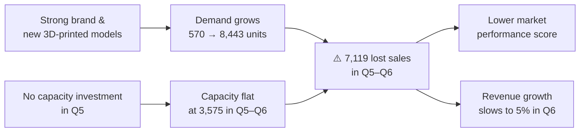

# 🏭 Operational Metrics
### Could FO Tread Bikes make enough bikes to meet demand? Q2–Q6

[← Dashboard Overview](../Dashboard%20Overview.md) · [Project overview](../../README.md)

---

## Contents
[Summary](#summary) · [Inventory Position](#inventory-position-produced-vs-demand) · [Capacity & Utilization](#capacity--utilization) · [Productivity](#worker-productivity) · [Why the Gap Opened](#why-the-gap-opened) · [What I'd Do Differently](#what-id-do-differently) · [Data Source](#data-source)

---

## Summary

| | |
|---|---|
| ✅ **Q2–Q4** | Production kept pace with demand (98–100% served in Q3–Q4) |
| ⚠️ **Q5–Q6** | Demand outran capacity: **7,119 bikes** in lost sales across the two quarters |
| 🏭 **Capacity** | Running at **100%** of effective capacity, with overtime, from Q4 on |
| 👷 **Productivity** | Worker productivity rose **30 points**, from 58.8% to 88.5% |
| 🔑 **Root cause** | No capacity investment in Q5, so Q6 capacity stayed flat while demand rose 51% |

---

## Inventory Position: Produced vs. Demand

**Inventory position** compares the bikes FO Tread could produce with the bikes customers wanted.

| Quarter | Units produced | Net demand | Lost sales (stock-outs) | Demand served |
|---|---|---|---|---|
| Q2 | 387 | 570 | 183 | 68% |
| Q3 | 659 | 659 | 0 | 100% |
| Q4 | 2,637 | 2,677 | 40 | 99% |
| Q5 | 3,371 | 5,608 | **2,237** | 60% |
| Q6 | 3,561 | 8,443 | **4,882** | **42%** |

**Formula:** lost sales = net demand − units produced

Every unit produced was sold, so production, not demand, set the limit on sales. By Q6, FO Tread could fill fewer than half of its orders. To meet Q6 demand, it would have needed about **2.4× its capacity**.

---

## Capacity & Utilization

| | Q2 | Q3 | Q4 | Q5 | Q6 |
|---|---|---|---|---|---|
| **Planned capacity** | 585 | 1,300 | 3,055 | 3,575 | 3,575 |
| **Planned capacity incl. overtime** | 658 | 1,300 | 3,437 | 4,022 | 4,022 |
| **Effective capacity** (after productivity) | 387 | 910 | 2,637 | 3,371 | 3,561 |
| **Utilization** | 100% | 72% | 100% | 100% | 100% |
| **Overtime used** | Yes | No | Yes | Yes | Yes |
| **Capacity investment** (cash flow) | $0.24M | $0.72M | $0.24M | **$0** | $0.24M |

**Formula:** effective capacity = planned capacity including overtime × worker productivity

- **Q3 was the only quarter with spare capacity:** 251 units of unused capacity, which cost **$30,069** in excess capacity charges.
- **From Q4 on, the plant ran flat out,** using every available unit of capacity plus overtime, which added about **$7.50 per bike** in labor cost.
- **Planned capacity did not grow from Q5 to Q6** (3,575 units), the same period demand jumped from 5,608 to 8,443.

---

## Worker Productivity

| | Q2 | Q3 | Q4 | Q5 | Q6 |
|---|---|---|---|---|---|
| **Productivity (with overtime)** | 58.8% | 70.0% | 76.7% | 83.8% | 88.5% |
| **Overtime labor cost per unit** | +$10.05 | — | +$7.61 | +$7.62 | +$7.49 |

Productivity improved every quarter, alongside investment in training, compensation, and system improvements, and earned the **Best Production Workers** trophy in Q5. Higher productivity squeezed more output from the same plant — Q6 produced 190 more bikes than Q5 with no added capacity — but it couldn't close a gap of nearly 5,000 units.

---

## Why the Gap Opened

1. **Demand surged.** Best Brand awards and new models grew demand 15× from Q2 to Q6.
2. **Capacity didn't keep up.** After Q3, capacity investment slowed, and **none was added in Q5**.
3. **The plant hit its ceiling.** With utilization at 100% and overtime already in use, productivity gains were the only source of extra output.
4. **The costs spread.** Lost sales held back revenue growth (just 5% in Q6) and pushed the market performance score to the industry's lowest (see [Balanced Scorecard](Balanced%20Scorecard.md)).

---

## What I'd Do Differently

| Decision | What happened | What I'd change |
|---|---|---|
| **Capacity planning** | Capacity stayed flat while demand grew 51% | Plan capacity from a demand forecast, with a buffer for growth |
| **Q5 investment** | Invested $0 in capacity despite record profit and $3.10M in cash | Reinvest Q5 profit in capacity ahead of the Q6 demand surge |
| **Balancing risk** | Q3's excess capacity cost $30K | Accept some excess-capacity cost: it's far smaller than thousands of lost sales |

---

## Data Source

- [Manufacturing, Q2–Q6](../../Data/Manufacturing%20Combined%20Q2%20to%20Q6.xlsm) — inventory position, capacity, utilization, overtime, and productivity
- [Cash Flow, Q1–Q6](../../Data/CashFlow%20(Q1%20to%20Q6).xlsx) — capacity investment by quarter

**Metrics used**

| Metric | Formula |
|---|---|
| Lost sales | Net demand − units produced |
| Demand served | Units sold ÷ net demand |
| Effective capacity | Planned capacity including overtime × productivity |
| Utilization | Effective capacity used ÷ effective capacity |

**Tool:** Microsoft Excel (grouped bar chart)
